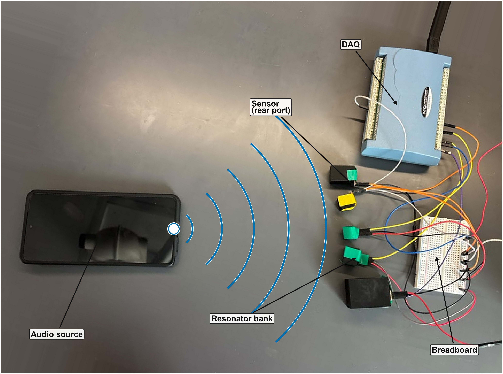

# Wave-Domain Speech Front End

Research code, compact-model benchmarks, and selected artifacts for a passive
five-resonator speech front end evaluated on AudioMNIST.



## Overview

The front end uses five microphone-coupled Helmholtz resonators with nominal
center frequencies of 300, 1800, 3500, 4500, and 7500 Hz. The resonators perform
frequency-selective acoustic filtering before classification. Compact neural
architectures are evaluated against a conventional 16 kHz, 40-bin log-Mel
reference on a fixed 36/12/12 speaker-disjoint AudioMNIST split.

The primary reported low-rate experiment uses five-channel, 100 Hz AC-RMS
envelopes with a 10 ms analysis interval. In the recorded proof of concept, the
five resonator sensor waveforms were acquired by the DAQ at high rate and the
AC-RMS envelopes were extracted in software. Therefore, the repository does not
claim measured ADC or analog-envelope-detector energy savings. A future analog
envelope stage before low-rate digitization is a deployment projection, not the
measured acquisition path represented by these results.

## Main Results

The Raspberry Pi 4 benchmark used CPU-only inference, batch size 1, one PyTorch
thread, the performance governor, and a 1.8 GHz Cortex-A72 CPU. The primary
100 Hz table is in
[`results/audiomnist/audiomnist_100hz_main_results.csv`](results/audiomnist/audiomnist_100hz_main_results.csv).

Across the nine paired architecture families, the 100 Hz resonator-envelope
models reduce preprocessing and neural-network computation substantially. The
accuracy tradeoff depends on architecture: the two smallest CNNs improve over
their log-Mel counterparts, while the higher-accuracy log-Mel models retain a
several-point advantage.

The energy columns use the measured Raspberry Pi dynamic draw of 0.30 W:

```text
t_comp = t_preprocessing + t_nn
E_dyn  = 0.30 W * t_comp
```

They describe compute-time energy on the benchmark platform, not complete
sensor-node energy and not the passive acoustic power handled by the resonators.

## Repository Layout

```text
src/audiomnist/              models, training, evaluation, and figure code
src/resonator_selection/     COMSOL-response subset-selection analysis
benchmark/raspberry_pi/      reproducible Raspberry Pi benchmark scripts
results/audiomnist/          primary 100 Hz and supporting 400 Hz tables
results/raspberry_pi/        per-system summaries, metadata, and raw timings
results/resonator_selection/ all 56 five-of-eight subset results
figures/                     selected paper-ready PDF and PNG figures
notebooks/generators/        scripts that build the Colab notebooks
```

## Data and Checkpoints

AudioMNIST audio, raw DAQ captures, generated feature caches, and trained model
checkpoints are intentionally not stored in this repository. AudioMNIST must be
obtained from its original distribution. The DAQ data and checkpoints are too
large for this curated source release and may also be subject to separate
distribution terms.

The public scripts preserve the exact fixed speaker split and preprocessing
definitions. Paths can be supplied through command-line arguments or the
configuration constants documented in each script.

## Environment

Create an environment and install the scientific Python dependencies:

```bash
python -m venv .venv
source .venv/bin/activate
pip install -r requirements.txt
```

Install a CPU build of PyTorch appropriate for the target platform separately.
The Raspberry Pi measurements in this release used PyTorch 2.14.0, while the
training scripts are not tied to that exact build.

Run the source-level tests from the repository root:

```bash
pytest -q src/audiomnist/test_benchmark_audiomnist_raspberry_pi.py
```

The energy-proxy plotting script additionally requires the archived model
summaries listed in `DATA_AVAILABILITY.md`; those larger source artifacts are
not included in this curated repository.

## Reproducibility Notes

- All normalization statistics are fitted on training speakers only.
- Checkpoint selection uses validation accuracy and loss; the test split is not
  used for training or model selection.
- MAC counts cover neural-network operations only. Preprocessing is timed
  separately on the Raspberry Pi.
- The 100 Hz and 400 Hz envelopes use the same 10 ms AC-RMS interval and differ
  in hop size.
- COMSOL screening used a separate A-Z dataset, not AudioMNIST.

See [`RESULTS.md`](RESULTS.md) for table definitions and
[`DATA_AVAILABILITY.md`](DATA_AVAILABILITY.md) for the files required to rerun
each stage.

## Citation

The ICASSP 2027 citation and arXiv identifier will be added when available.

## License

No software or media license is granted by this repository at this time. The
materials are public for research transparency; copyright remains with the
authors unless a file states otherwise.
